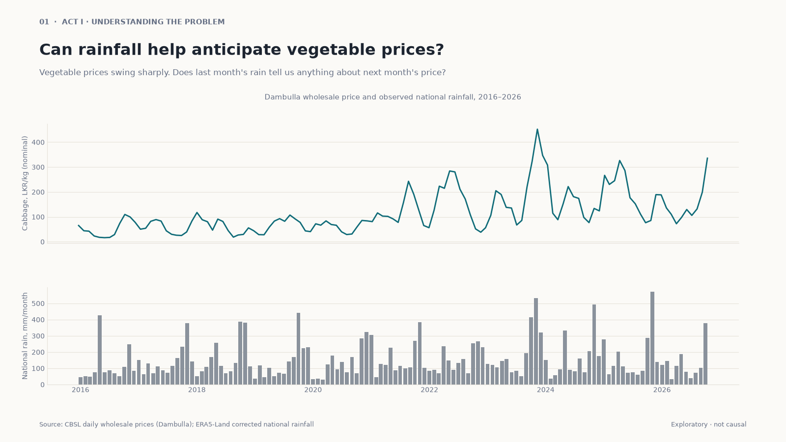

# 01 - Can rainfall help anticipate vegetable prices?

**Demonstrates:** Problem framing and communication

## Purpose
Open with one question the audience can hold for the whole presentation.

## Story
Vegetable prices swing sharply and weather might carry advance information. Whether it does is an empirical question, not an assumption.

## Visual
Two stacked time series on a shared axis: Dambulla cabbage wholesale price (line) above national monthly rainfall (bars), 2016-2026. Chosen because the eye naturally asks whether the two move together; that is the question.

## Evidence
CBSL daily wholesale prices (`raw/cbsl-daily-prices.csv`), monthly mean; ERA5-Land corrected national rainfall (`research_audit/derived/era5_regional_monthly.csv`).

## Explanation
Prices matter to consumers and farmers. I do not claim rain causes price changes. I ask a narrower, testable thing: does observed rainfall improve one-month-ahead forecasts beyond what past prices already tell us?

## Interpretation
No result yet. The picture invites an impression that the later pages test properly.

## Limitations
Do not read the picture as evidence of a relationship. Nominal prices, one vegetable shown.

## Transition
To test the question we must define exactly what is being forecast and from which data (page 2).
