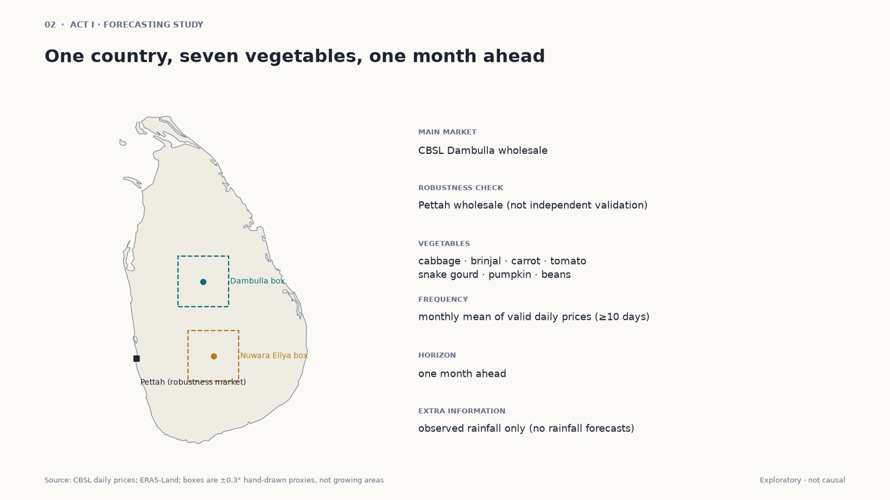

# 02 - One country, seven vegetables, one month ahead

**Story stage:** Context

## What this page communicates
This is a focused study of seven wholesale vegetable prices, not a national consumer-price forecasting system.

## Why this page exists
Readers must know the scope before judging the results; it also pre-empts over-generalisation.

## What I explain
Main market is Dambulla wholesale; Pettah is a robustness check. Seven vegetables, monthly prices, one month ahead, observed rainfall only. The dashed boxes are the regional rainfall proxies used as secondary checks.

## Evidence
Scope table from `forecast_backtest_report_v2.md`; boxes are +/-0.3 degrees around Dambulla (7.86N, 80.65E) and Nuwara Eliya (6.97N, 80.77E), 36 land cells each.

## Important qualification
The boxes are hand-drawn proxies, not measured growing areas. Pettah is a related market, not independent replication.

## Chart specification
Map: Sri Lanka outline (`raw/chirp/boundaries/countries.geojson`) with two dashed boxes and the Pettah marker. Right: scope list.

## Connection to the next page
Page 3 shows where the numbers come from and how they were cleaned.
