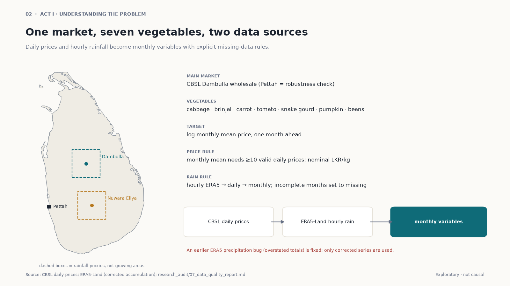

# 02 - One market, seven vegetables, two data sources

**Demonstrates:** Research scope and data-source understanding

## Purpose
Fix scope and data before any result so the findings cannot be over-generalised.

## Story
A focused study: Dambulla wholesale, seven vegetables, monthly, one month ahead, built from CBSL prices and ERA5-Land rain under explicit rules.

## Visual
Left: Sri Lanka outline with the Dambulla and Nuwara Eliya rainfall boxes and the Pettah market. Right: scope facts and a three-box flow (CBSL prices + ERA5 rain -> monthly variables). Map plus flow answers 'where' and 'how'.

## Evidence
`research_audit/07_data_quality_report.md`; boxes are +/-0.3 degrees around Dambulla (7.86N, 80.65E) and Nuwara Eliya (6.97N, 80.77E), 36 land cells each; incomplete rainfall months (2009-12, 2026-11) set to missing; monthly price needs at least 10 valid daily prices.

## Explanation
Pettah is a robustness check, not independent validation. An earlier ERA5 precipitation processing bug overstated rainfall; the corrected series is used. Prices are nominal.

## Interpretation
The study is about selected wholesale prices, not consumer inflation or all markets.

## Limitations
Boxes are hand-drawn proxies, not growing areas. No deflator is applied.

## Transition
With the data fixed, page 3 looks at how prices and rainfall actually behave.
