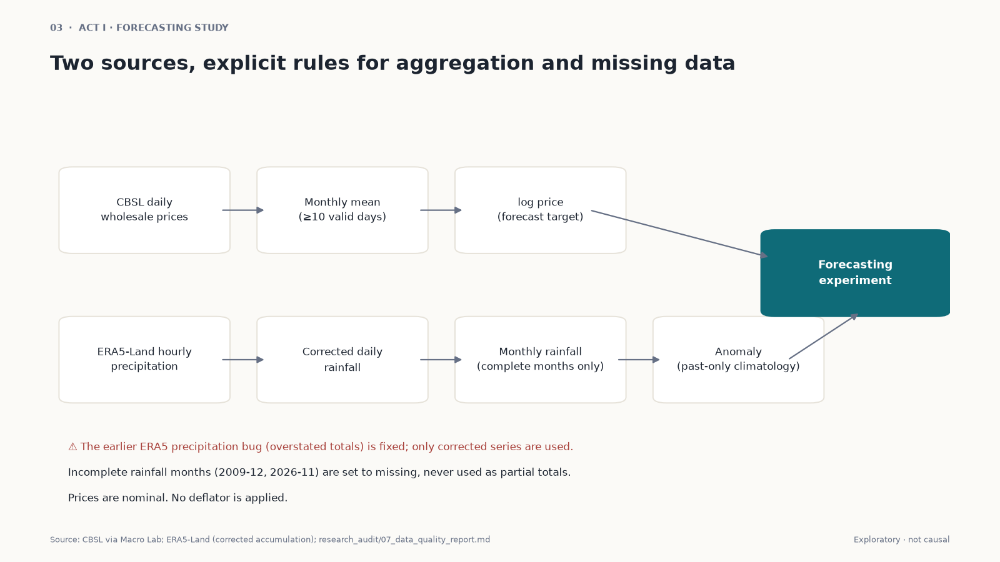

# 03 - Two sources, explicit rules

**Story stage:** Context

## What this page communicates
The experiment joins CBSL prices and ERA5 rainfall under stated aggregation and missing-data rules.

## Why this page exists
Credibility. The audience should see the data limits before the results, not after.

## What I explain
Prices become monthly means (at least 10 valid days), then logs. Rainfall goes from hourly ERA5 to corrected daily to monthly to anomalies. Months with incomplete rainfall are missing, never partial totals.

## Evidence
`07_data_quality_report.md`; `derived/era5_regional_monthly.csv` (incomplete: 2009-12 and 2026-11 only).

## Important qualification
An earlier ERA5 precipitation bug overstated totals; only the corrected series are used. Prices are nominal.

## Chart specification
Two-row flow diagram merging into the experiment box. Schematic, no data axes.

## Connection to the next page
Page 4 looks at the thing being forecast: the price series.
