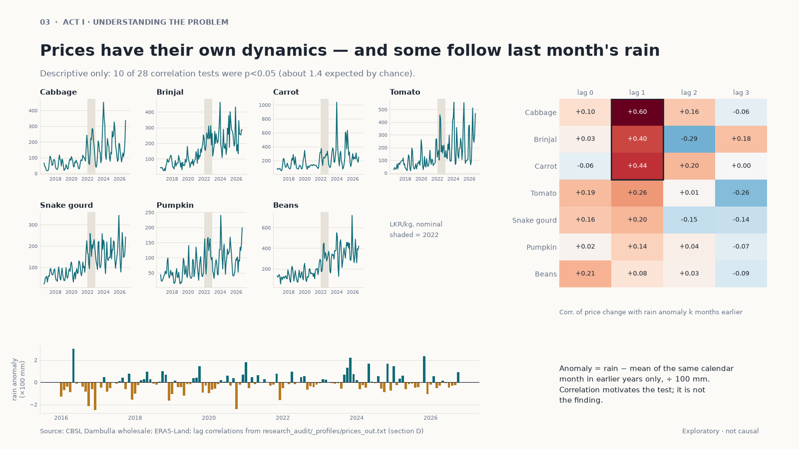

# 03 - Prices have their own dynamics, and some follow last month's rain

**Demonstrates:** Data processing and exploratory analysis

## Purpose
Show the target series and the first hints that justify a forecasting test.

## Story
Prices trend, spike and carry the 2022 shock. Rainfall anomalies are known when forecasts are made. Cabbage, carrot and brinjal correlate most with last month's rain; this motivates the test but proves nothing.

## Visual
Small multiples of the seven price series (shaded 2022); a lag-0 to lag-3 correlation heat map with lag-1 top three outlined; a rain-anomaly bar strip underneath. Heat map is the right form for vegetable-by-lag comparison; small multiples keep each series readable.

## Evidence
CBSL monthly means; ERA5 anomaly = rain minus same-calendar-month mean of earlier years, divided by 100 mm; correlations from `research_audit/_profiles/prices_out.txt` section D (copied to `03_prices_and_rain/assets/lag_correlations.csv`).

## Explanation
Lag-1: cabbage +0.60, carrot +0.44, brinjal +0.40. 10 of 28 tests were nominally significant versus about 1.4 expected by chance, so I treat this as a pointer, not a finding.

## Interpretation
Price history already has structure, so a fair test must give the baseline model that structure.

## Limitations
Many tests, short series, exploratory. Correlation is not forecasting skill and not causation.

## Transition
Page 4 turns the hint into a controlled comparison.
