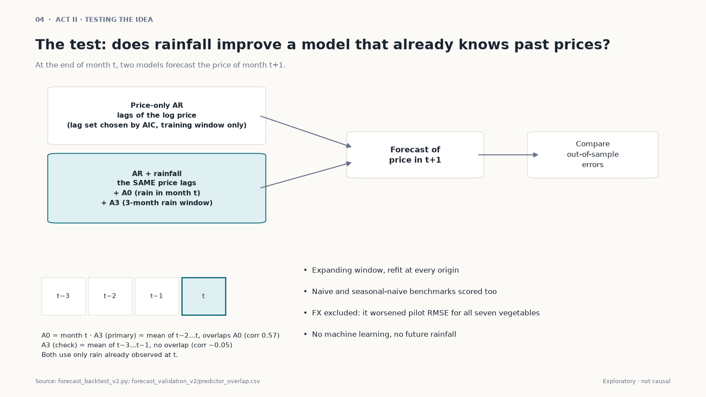

# 04 - The test: does rainfall improve a model that already knows past prices?

**Demonstrates:** Model design and forecasting methodology

## Purpose
Explain the experiment well enough that an evaluator could reproduce it.

## Story
Two models forecast the next month. One uses past prices only; the other adds rainfall with identical price lags. Any difference is attributable to rainfall information.

## Visual
Top: two model boxes to a forecast box to an error comparison. Bottom: month window t-3...t showing A0 and the two A3 definitions, plus design bullets. A flow diagram suits a procedure; the window strip answers the A0/A3 overlap question directly.

## Evidence
`forecast_backtest_v2.py`; `forecast_validation_v2/predictor_overlap.csv` (corr(A0,A3) = 0.57 primary, -0.05 non-overlapping).

## Explanation
Lag set chosen by AIC on training rows only, shared between models. A0 is month t rain; A3 in the primary is the mean of t-2, t-1, t, so it overlaps A0. This is not leakage but the predictors are correlated; the non-overlapping version is a check. Naive and seasonal-naive benchmarks are also scored. FX is excluded because it worsened pilot RMSE for all seven vegetables.

## Interpretation
The design isolates the marginal value of rain over price history.

## Limitations
No machine learning, no future rainfall, no causal reading.

## Transition
Page 5 explains how forecasts are scored and tested.
