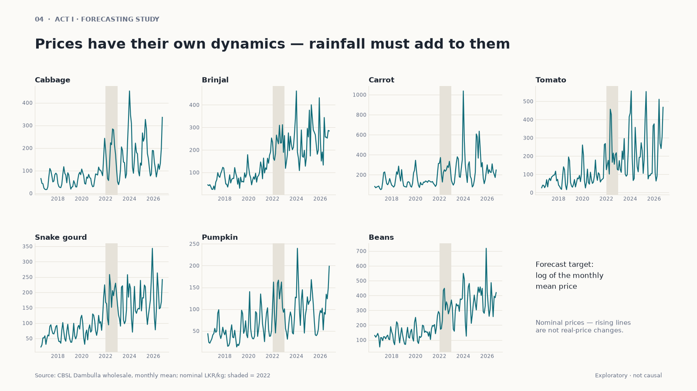

# 04 - Prices have their own dynamics

**Story stage:** Context

## What this page communicates
Each vegetable price has trends, seasonality and shocks of its own, so rainfall must add to a model that already uses past prices.

## Why this page exists
Motivates the comparison design: the fair baseline is a price-only model, not no model.

## What I explain
Seven small multiples on a common time axis. 2022 is shaded because the economic crisis moves everything. The target is the log of the monthly mean.

## Evidence
CBSL Dambulla wholesale, monthly mean of valid daily prices.

## Important qualification
Nominal prices: rising lines are not real-price increases. No deflator is applied.

## Chart specification
Small multiples 2x4, one panel per vegetable, y free per panel, shaded band = 2022. LKR/kg.

## Connection to the next page
Page 5 builds the rainfall side of the comparison.
