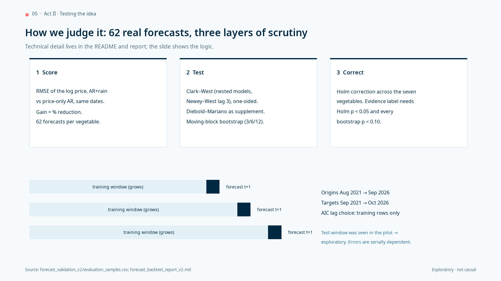

# 05 - How we judge it: 62 real forecasts, three layers of scrutiny

**Demonstrates:** Statistical reasoning and validation

## What to say
A forecast model is easy to flatter. So I want to show you the three layers I used to judge it.

First, scoring. For each vegetable I make 62 real one-month-ahead forecasts, from August 2021 to September 2026. For each one, the model only sees data available at that time, and it is refit every month. I measure the error of each model and report the percentage reduction in error from adding rainfall.

Second, testing. A reduction could be luck, so I test it. The right test for two models where one is a special case of the other is the Clark-West test, and I use it with an adjustment for the fact that forecast errors in adjacent months are related. I also run a Diebold-Mariano comparison and a block bootstrap as supplements.

Third, correction. I am testing seven vegetables, so by chance one might look good. The Holm correction adjusts for that. My label for supported requires the corrected p-value below 0.05 and every bootstrap p-value below 0.10.

You can drag the slider to see this working: it moves the forecast origin forward, the shaded training window grows, and the two forecasts are compared with what actually happened.

And one limit I must state: I looked at this test period in an earlier pilot, so this is exploratory, not an independent confirmation.

## Key points to land
- 62 forecasts per vegetable, each made only from data available at the time.
- Test, then correct for seven comparisons: Clark-West then Holm.
- The test window was seen in the pilot, so results are exploratory.

## In plain words
Imagine going back to August 2021 and forecasting each next month using only what you knew then, 62 times, and keeping score. That is the experiment.

## For the technical evaluator
Expanding-window rolling origin. The Clark-West test (one-sided, with Newey-West variance, lag 3) tests whether the larger nested model has lower expected squared error. Diebold-Mariano is two-sided and supplementary. A moving-block bootstrap with block lengths 3, 6 and 12 and 4,000 draws gives a distribution-free check. Holm controls the family-wise error across the seven vegetables.

## If someone asks
**"Is 62 forecasts enough?"**  
It is modest, and the errors in neighbouring months are related, so the information is less than 62 independent tests. That is why I use tests designed for dependent forecast errors and describe the result as exploratory.

**"Why Holm and not just a p-value?"**  
With seven tests, the chance that at least one looks significant by luck is much higher than five percent. Holm adjusts for that, while being less conservative than Bonferroni.

**"You looked at this window before. Does that matter?"**  
Yes, and I say so. Choices made after seeing the same period can flatter the result. The corrected tests help but cannot remove that, so I call the results exploratory and recommend testing on newly published months.

**"What does the slider on the chart show?"**  
One forecast at a time, the month I forecast from, the actual outcome and the two models' predictions. It shows how the experiment works, not the evidence. The evidence is all 62 together on the next slide.

## Evidence behind the slide
`forecast_validation_v2/evaluation_samples.csv`: first origin 2021-08, last origin 2026-09, n = 62 for all seven vegetables, identical with or without the secondary specifications. Constants in `forecast_backtest_v2.py`: Newey-West lag 3, 4,000 bootstrap draws, blocks 3/6/12, evidence label requires Holm Clark-West p < 0.05 and every bootstrap p < 0.10. The pilot replayed in the audit started testing around July 2021 (63 tests), almost the same window.

## What not to claim
- Do not call the result confirmed or significant without saying exploratory.
- Do not say 62 independent experiments.
- Do not treat the single forecast on the slider as evidence.

## On the slide
- Drag the origin slider from August 2021 forward and watch the training window grow.
- Switch vegetable to show the same set-up for another vegetable.

## Hand-over to the next page
With the method and its safeguards clear, here is what the test found.
