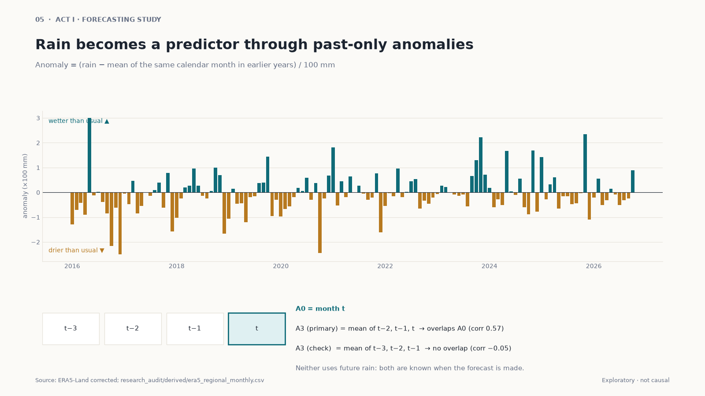

# 05 - Rain becomes a predictor through past-only anomalies

**Story stage:** Context

## What this page communicates
Rainfall enters as an anomaly against a climatology that uses only earlier years, so it is known at forecast time.

## Why this page exists
Explains the predictor so the later results are interpretable; also records the A0/A3 overlap openly.

## What I explain
Anomaly = rain minus the mean of the same calendar month in earlier years, divided by 100 mm. A0 is month t. In v2, A3 is the mean over t-2, t-1, t and so overlaps A0 (correlation 0.57). The validation also uses t-3 to t-1 (correlation -0.05).

## Evidence
`predictor_overlap.csv`; `forecast_rain_window_sensitivity.md` section 1.

## Important qualification
Overlap is not leakage (both use only past rain), but the predictors are correlated. National rain is primary; boxes are secondary.

## Chart specification
Top: monthly anomaly bars (diverging, two hues, zero line). Bottom: window schematic t-3...t with A0/A3 definitions.

## Connection to the next page
Page 6 shows the early correlations that pointed us to these vegetables.
