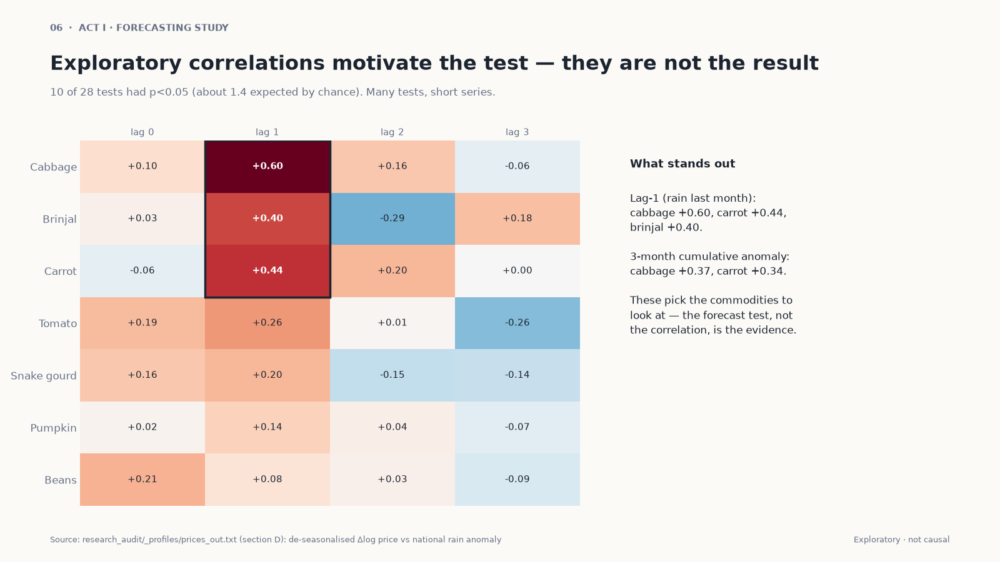

# 06 - Exploratory correlations motivate the test

**Story stage:** Dispute

## What this page communicates
Some vegetables correlate with last month's rain, which is why we test forecasting; correlation is not the result.

## Why this page exists
Honest chain of reasoning: the heat map prompted the question, but 28 tests on a short series cannot be the headline.

## What I explain
Lag-1 correlations: cabbage +0.60, carrot +0.44, brinjal +0.40. 10 of 28 tests were nominally significant against about 1.4 expected by chance. That is enough to look closer, not enough to conclude.

## Evidence
`research_audit/_profiles/prices_out.txt` section D; values copied to `assets/lag_correlations.csv`.

## Important qualification
Many tests, short series, de-seasonalised changes. These figures are exploratory.

## Chart specification
Heat map: rows = 7 vegetables, columns = lags 0-3, diverging blue-red, value in each cell, outline on lag-1 top three.

## Connection to the next page
Page 7 turns the hint into a proper out-of-sample forecasting test.
