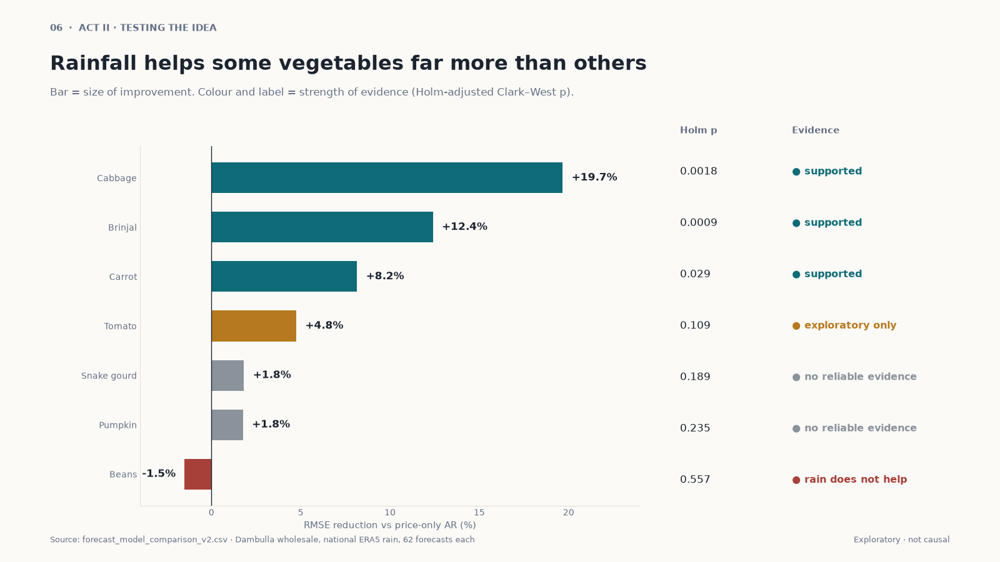

# 06 - Rainfall helps some vegetables far more than others

**Demonstrates:** Results interpretation and visual communication

## Purpose
The centrepiece: answer whether rainfall helps, vegetable by vegetable.

## Story
Cabbage, brinjal and carrot improve materially and survive correction. Tomato is only suggestive. Snake gourd and pumpkin show little. Beans get slightly worse.

## Visual
Horizontal bars for RMSE gain, fixed vegetable order, zero line, with Holm p and an evidence label beside each bar. Colour is teal for supported, amber for exploratory, grey for none, red for worse, and the label repeats it so colour is not the only cue. Size and strength are kept separate on purpose.

## Evidence
`forecast_model_comparison_v2.csv`: Dambulla, mean price, national rain. Gains 19.7 / 12.4 / 8.2 / 4.8 / 1.8 / 1.8 / -1.5 percent; Holm CW p 0.0018 / 0.0009 / 0.0285 / 0.109 / 0.189 / 0.235 / 0.557.

## Explanation
Carrot has a smaller gain than brinjal but both pass; tomato looks positive but does not. The value of rain is commodity-specific.

## Interpretation
Observed rainfall carries out-of-sample information about next month's price for some vegetables beyond past prices.

## Limitations
Not causal. Re-used test window. Carrot is borderline. Dambulla only.

## Transition
Page 7 asks whether this survives other reasonable choices.
