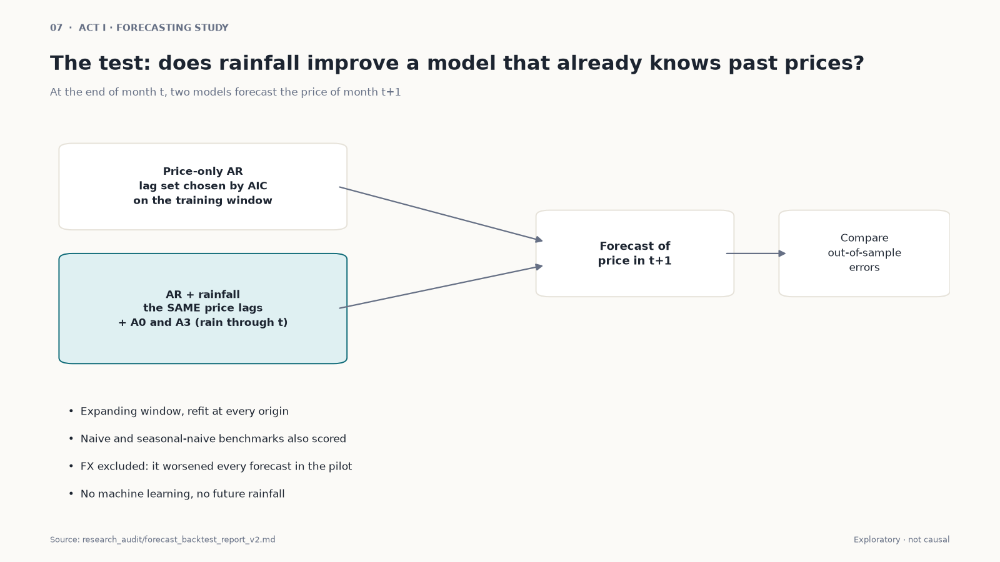

# 07 - The test: does rainfall improve a model that already knows past prices?

**Story stage:** Investigation

## What this page communicates
The comparison is price-only AR against AR plus rainfall with identical price lags.

## Why this page exists
This is the core design; everything after depends on it being fair.

## What I explain
At the end of month t both models forecast month t+1. The price lag set is chosen by AIC on the training window and shared, so any difference comes from rainfall alone. Naive and seasonal-naive are benchmarks. FX is excluded because it worsened forecasts in the pilot.

## Evidence
`forecast_backtest_v2.py`; validation asserts identical lag columns.

## Important qualification
No machine learning, no future rainfall. This is a research instrument, not a prediction product.

## Chart specification
Schematic: two model boxes feeding a forecast box, then an error comparison.

## Connection to the next page
Page 8 explains how the forecasts are scored.
