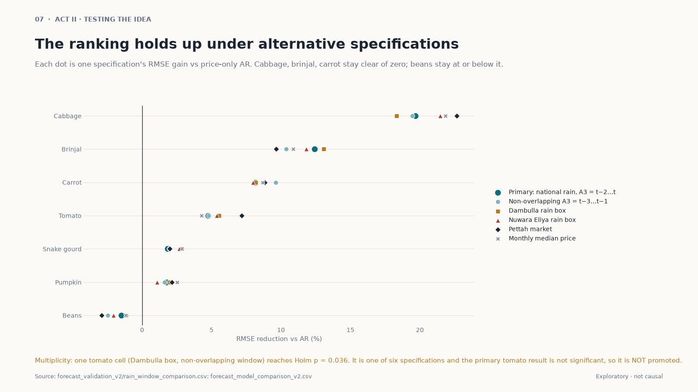

# 07 - The ranking holds up under alternative specifications

**Demonstrates:** Robustness testing and research judgement

## What to say
A good result should not depend on one arbitrary choice, so here is the same comparison under several different choices.

Each row is a vegetable. Each marker is one version of the analysis: my primary specification, the non-overlapping rainfall window, rainfall from a box around Dambulla, rainfall from a box around Nuwara Eliya, the Pettah market instead of Dambulla, and the monthly median price instead of the mean.

What I want you to see is that the order barely changes. Cabbage, brinjal and carrot sit well to the right of zero in every version. Beans sit at or below zero. Moving between rainfall geographies changes the gain by under four percentage points.

Brinjal is the most sensitive: its gain falls from 12.4 to 10.4 percent with the non-overlapping window, but it still passes correction.

I also need to tell you about one result I am deliberately not promoting. For tomato, one secondary version, the Dambulla box with the non-overlapping window, reaches a corrected p-value of 0.036. That is one of six versions and the primary tomato result is not significant. If you test enough versions, one will cross the line by chance, so I do not use it.

Pettah showing the same pattern is reassuring, but both series come from the same source, so it is consistency, not replication.

## Key points to land
- Same ranking across windows, rain geographies, a second market and median prices.
- The one tomato cell that passes is not promoted: one of six, and the primary tomato result does not pass.
- Pettah shows consistency, not independent confirmation.

## In plain words
I asked: would a different but reasonable choice give a different answer? For the vegetables that mattered, it did not.

## For the technical evaluator
The Holm correction is applied within each specification across the seven vegetables, not across specifications, so the secondary rows are not one pre-planned family of tests. That is why they are labelled exploratory and why the tomato cell cannot override the primary result.

## If someone asks
**"Why not report the tomato result that is significant?"**  
Because it was found by looking across several specifications after the fact. Its three bootstrap p-values (0.097, 0.098, 0.074) are also not convincing, and the primary specification, which I fixed in advance, does not support it.

**"Does the ranking really hold for every vegetable?"**  
For the point estimates of cabbage, brinjal, carrot and beans, yes. Snake gourd, pumpkin and tomato have small positive point estimates in most versions, with no reliable evidence for snake gourd and pumpkin, and tomato exploratory.

**"Is Pettah a second test?"**  
No. It is a related market with the same rainfall series, so agreement increases confidence a little but is not independent evidence.

**"What changes if you drop 2022?"**  
In the main report, cabbage and carrot keep their gains without 2022. Brinjal's gain is concentrated in the second half of the period, and tomato's disappears in the second half.

## Evidence behind the slide
`forecast_validation_v2/rain_window_comparison.csv` and `forecast_model_comparison_v2.csv` (Pettah, median price). No vegetable changes evidence class between the overlapping and non-overlapping window; brinjal 12.4 to 10.4, carrot 8.2 to 9.6, cabbage 19.7 to 19.5. Spread across national and the two boxes is under 4 percentage points. Tomato Dambulla-box non-overlapping: Holm CW p = 0.036, bootstrap p 0.097, 0.098, 0.074.

## What not to claim
- Do not use the tomato cell as a finding.
- Do not describe Pettah as replication or the boxes as growing areas.
- Do not say the secondary specifications were corrected as one family.

## On the slide
- Untick all but the primary and the non-overlapping window to show they stay close.
- Re-tick everything, then trace the tomato row to show the markers cluster in the same place.

## Hand-over to the next page
Even a robust improvement says nothing about how good the forecasts are in absolute terms. That is the next question.
