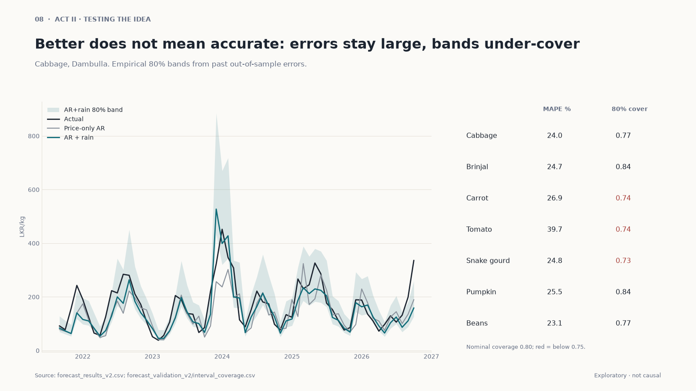

# 08 - Better does not mean accurate

**Demonstrates:** Understanding of uncertainty and model limitations

## Purpose
Stop the audience reading a relative gain as a usable forecast.

## Story
Rain improves forecasts relative to the baseline, but errors remain large and the empirical 80% bands cover less than 80%.

## Visual
Actual, price-only and AR+rain forecasts for cabbage with an empirical 80% band, next to a table of MAPE and actual coverage per vegetable. The line chart shows spikes missed; the table puts every vegetable on one scale.

## Evidence
`forecast_results_v2.csv`; `forecast_validation_v2/interval_coverage.csv`. MAPE 23-40 percent; coverage 0.73-0.84 for AR+rain.

## Explanation
The model tracks direction but misses spikes. Bands come from past out-of-sample errors and under-cover, so I print actual coverage rather than calling them calibrated.

## Interpretation
Useful as research evidence about information content; not as an operational price forecast.

## Limitations
Coverage estimates have a standard error of about 0.05 with 62 points; fixed-climatology interval history uses some warm-up errors that rely on later climatology.

## Transition
Page 9 widens to the food system around these prices.
