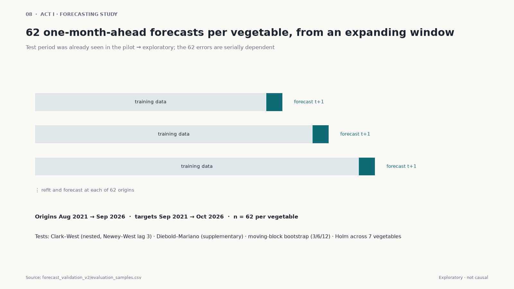

# 08 - 62 forecasts per vegetable, from an expanding window

**Story stage:** Investigation

## What this page communicates
Models are refit at each origin and scored on 62 real one-month-ahead forecasts per vegetable.

## Why this page exists
Makes the evaluation transparent and states its main weakness up front.

## What I explain
Origins August 2021 to September 2026. Tests: Clark-West for nested models, Diebold-Mariano as supplement, moving-block bootstrap, Holm correction across seven vegetables.

## Evidence
`forecast_validation_v2/evaluation_samples.csv` (n = 62 for all).

## Important qualification
The test period was seen in the pilot, so results are exploratory. The 62 errors are serially dependent and carry less information than 62 independent trials.

## Chart specification
Timeline of three expanding training bars with a forecast tick; annotation of origins and tests.

## Connection to the next page
Page 9 reveals the result.
