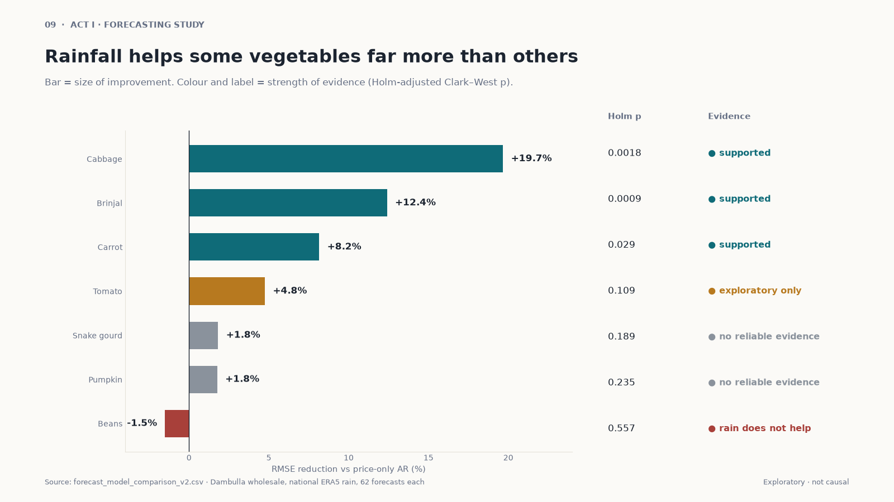

# 09 - Rainfall helps some vegetables far more than others

**Story stage:** Evidence

## What this page communicates
Cabbage, brinjal and carrot improve materially and survive correction; tomato is only suggestive; the rest do not.

## Why this page exists
Central result. Effect size and evidence strength are shown separately so a big gain is not mistaken for a certain one.

## What I explain
Read bar length as improvement and colour as evidence. Cabbage +19.7%, brinjal +12.4%, carrot +8.2% pass Holm. Tomato +4.8% (p = 0.109) does not. Snake gourd and pumpkin gain under 2%. Beans get slightly worse.

## Evidence
`forecast_model_comparison_v2.csv`: Dambulla, mean price, national rain, 62 forecasts.

## Important qualification
Association in forecasting skill, not causation. The test window was previously examined.

## Chart specification
Horizontal bars (zero line labelled), fixed vegetable order, right-hand columns for Holm p and evidence label. Colours: teal supported, amber exploratory, grey none, red worse.

## Connection to the next page
Page 10 asks if this depends on how the rain window is defined.
