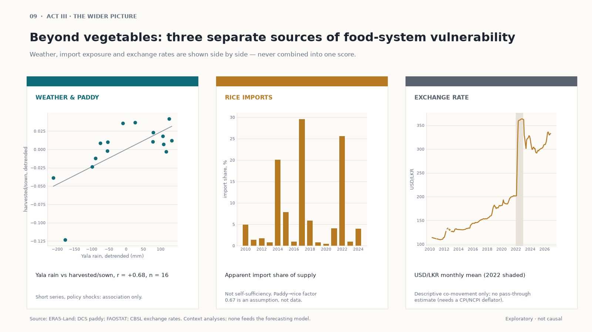

# 09 - Beyond vegetables: three separate sources of food-system vulnerability

**Demonstrates:** Connecting analysis to a wider industry problem

## What to say
Vegetable prices are one part of a bigger picture, so here are three other dimensions of food-system vulnerability. I want to be very clear that these are context, not inputs to the forecasting model, and I am deliberately not combining them into one score.

On the left, weather and paddy. For the rice crop, rainfall in the main Yala season goes along with how much of the sown area is actually harvested. After removing trends the correlation is plus 0.68 across 16 seasons. It is an association in a short series, and policy shocks in 2021 and 2022 sit in that period.

In the middle, rice imports. I show an apparent import share: imports divided by production plus imports. It peaks in 2017 at about 30 percent, in 2022 at about 26 percent, and in 2014 at about 20 percent. Those are low-production years and 2022. This is not self-sufficiency: it ignores stocks, feed, seed and waste, and the conversion from paddy to rice uses an assumed factor of 0.67, which is an assumption, not data.

On the right, the exchange rate. The dollar exchange rate rose by about 80 percent between December 2021 and December 2022, to about 363 rupees per dollar. But I show it as descriptive co-movement only. Without an inflation deflator I cannot estimate how much of that reaches food prices, and I make no pass-through claim.

## Key points to land
- Three separate dimensions, shown side by side and never combined into a score.
- Weather and paddy: plus 0.68 over 16 seasons, detrended; an association only.
- Rice imports are an apparent share, with the 0.67 conversion an assumption; the exchange-rate panel is descriptive only.

## In plain words
Weather, imports and the exchange rate each expose the food system to risk in a different way. I show them one by one rather than adding them up.

## For the technical evaluator
Production versus imports: Pearson r = -0.79 (n = 15, 2010-2024) between detrended paddy production and FAO rice imports in the same year; -0.46 (n = 13) after dropping 2017 and 2022, with production detrended once on all 15 years. The all-years Spearman is -0.59. Comtrade has no 2018 annual data and 2025 is partial, so FAOSTAT trade is used for the import share.

## If someone asks
**"Does this show that weather causes the import spikes?"**  
No. The import share rises in low-production years and in 2022, but several other things happened in those years. I show the pattern without claiming a cause.

**"Why not combine the three into a vulnerability index?"**  
Their evidence strengths differ a lot: forecasts have 62 test points, imports about 15 years, the exchange rate has no deflator yet. A single score would hide that.

**"What would you need to estimate exchange-rate pass-through?"**  
A consumer price index or similar deflator, a defined food-price series and a model for lags. That is the next piece of work.

**"Why is the conversion factor 0.67 not sourced?"**  
It is a documented project assumption for milling from paddy to rice. I treat it as an assumption and flag it on the slide rather than presenting it as data.

## Evidence behind the slide
Yala (March-August) ERA5 rain against DCS harvested/sown, 2010-2025, detrended, r = +0.68, n = 16. Apparent import share from `derived/rice_annual_balance.csv`: 2017 29.6 percent, 2022 25.6 percent, 2014 20.1 percent, i.e. peaks in low-production years (2014, 2017) and in 2022. Rice-equivalent production uses an assumed 0.67 milling factor (`research_audit/02_variable_catalogue.md`). CBSL USD/LKR monthly mean: Dec-2022 about 363, about +80 percent on Dec-2021. Descriptive co-movement only; no pass-through estimate.

## What not to claim
- Do not claim exchange-rate pass-through or that depreciation caused food-price rises.
- Do not call the import share self-sufficiency.
- Do not combine the three panels into one score or one causal chain.

## On the slide
- Hover individual points on the scatter and the bars to read values.
- Point to the 2022 shaded band on the exchange-rate chart.

## Hand-over to the next page
That completes the evidence. The last slide pulls together what was found, what limits it, and what comes next.
