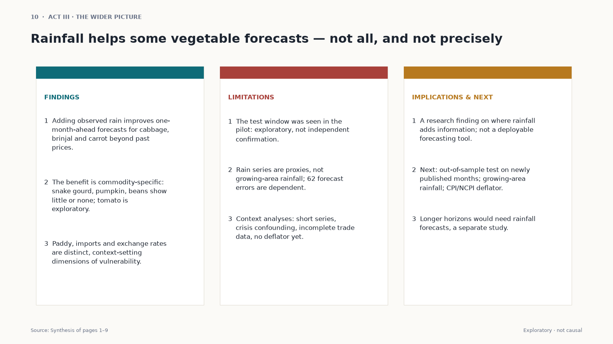

# 10 - What have we learned?

**Demonstrates:** Critical thinking and communicating conclusions

## Purpose
Close with the answer, its limits and the next steps.

## Story
Rainfall carries short-term price information for some vegetables, not all and not precisely; the wider food system has several distinct vulnerabilities.

## Visual
Three columns: findings, limitations, implications and next steps, each three numbered statements. Plain text because the audience should leave with sentences, not another chart.

## Evidence
Pages 1-9; `research_audit/06_recommended_research_direction.md`.

## Explanation
Three findings, three limitations, then the boundary: this is a research finding, not a deployable tool. Next: test on newly published months, use growing-area rainfall, add a CPI/NCPI deflator; longer horizons would need rainfall forecasts.

## Interpretation
The contribution is where rainfall adds information and where it does not.

## Limitations
Exploratory results from a re-used test window; proxies for rainfall; dependent errors.

## Transition
End of story.
