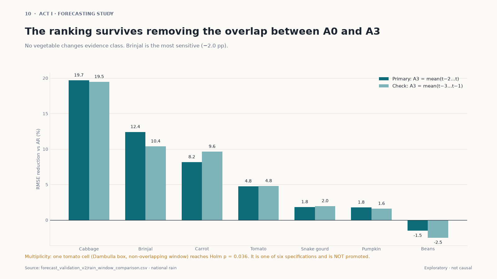

# 10 - The ranking survives removing the A0/A3 overlap

**Story stage:** Challenge

## What this page communicates
Replacing A3 with a non-overlapping window changes sizes by a few points and no evidence class.

## Why this page exists
A reviewer flagged the overlap; this page answers it directly.

## What I explain
Cabbage 19.7 to 19.5, brinjal 12.4 to 10.4, carrot 8.2 to 9.6, tomato unchanged at 4.8. Brinjal is most sensitive but stays supported.

## Evidence
`forecast_validation_v2/rain_window_comparison.csv`; v2 reproduced exactly (434 forecasts, max difference 0.0).

## Important qualification
A tomato cell in one regional specification reaches Holm p = 0.036. It is one of six specifications, the primary tomato result is not significant, and it is not promoted.

## Chart specification
Paired bars per vegetable: primary vs non-overlapping, values labelled, zero line.

## Connection to the next page
Page 11 asks if the geography of the rainfall matters.
