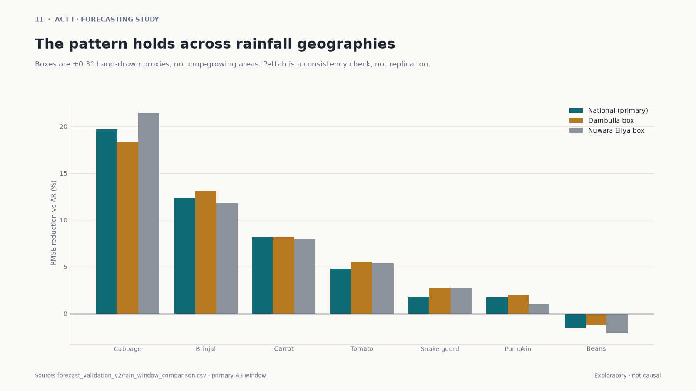

# 11 - The pattern holds across rainfall geographies

**Story stage:** Challenge

## What this page communicates
National, Dambulla-box and Nuwara Eliya-box rainfall give broadly similar gains.

## Why this page exists
Tests whether the finding is an artefact of one rainfall aggregate.

## What I explain
The commodity ranking is stable across the three geographies. Cabbage, brinjal and carrot keep positive gains in all.

## Evidence
`rain_window_comparison.csv` (nat/dam/nuw, primary window).

## Important qualification
Boxes are proxies. Pettah results show consistency, not replication.

## Chart specification
Grouped bars: 3 geographies x 7 vegetables, zero line.

## Connection to the next page
Page 12 puts the gains in perspective by showing absolute error.
