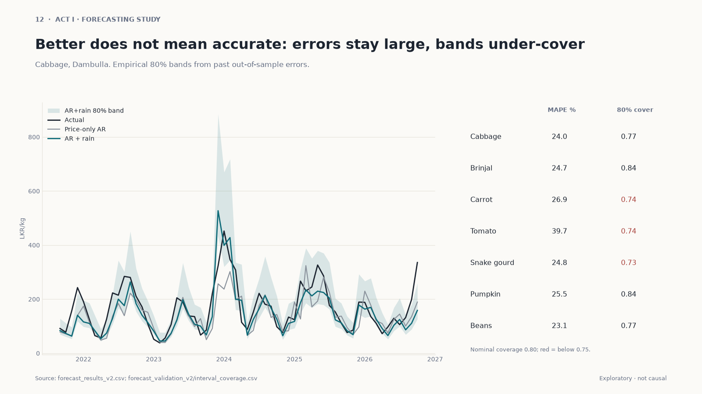

# 12 - Better does not mean accurate

**Story stage:** Challenge

## What this page communicates
Relative improvement still leaves large errors, and the empirical 80% bands cover less than 80% of outcomes.

## Why this page exists
Prevents the audience reading an RMSE gain as a usable forecast.

## What I explain
Cabbage: forecasts track direction but miss spikes. MAPE is 23-40%. Coverage of the 80% bands is 0.73-0.84.

## Evidence
`forecast_results_v2.csv`; `interval_coverage.csv` (national, primary window).

## Important qualification
Bands are empirical, built from past errors, with standard error of coverage about 0.05. Do not call them calibrated.

## Chart specification
Left: actual, AR, AR+rain lines with band. Right: table of MAPE and coverage, red below 0.75.

## Connection to the next page
Page 13 summarises what has been shown.
