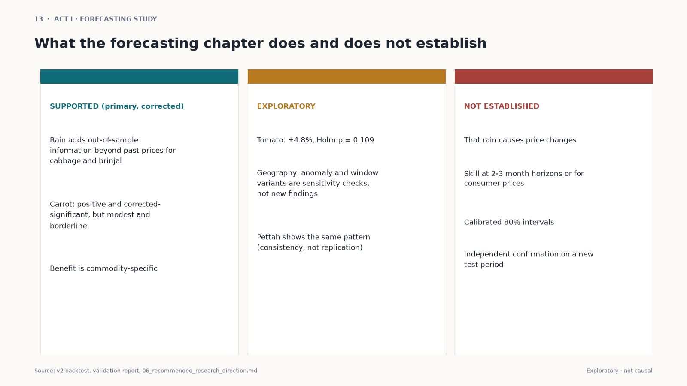

# 13 - What the forecasting chapter does and does not establish

**Story stage:** Resolution

## What this page communicates
Rain adds predictive information for selected vegetables; causation, longer horizons and calibrated intervals are not established.

## Why this page exists
A disciplined summary before widening the scope.

## What I explain
Three columns: supported, exploratory, not established.

## Evidence
Pages 9-12.

## Important qualification
Test window re-used; proxies for rainfall; dependent errors.

## Chart specification
Three-column layout with colour bars and short bullets.

## Connection to the next page
Page 14 steps back to the wider food system.
