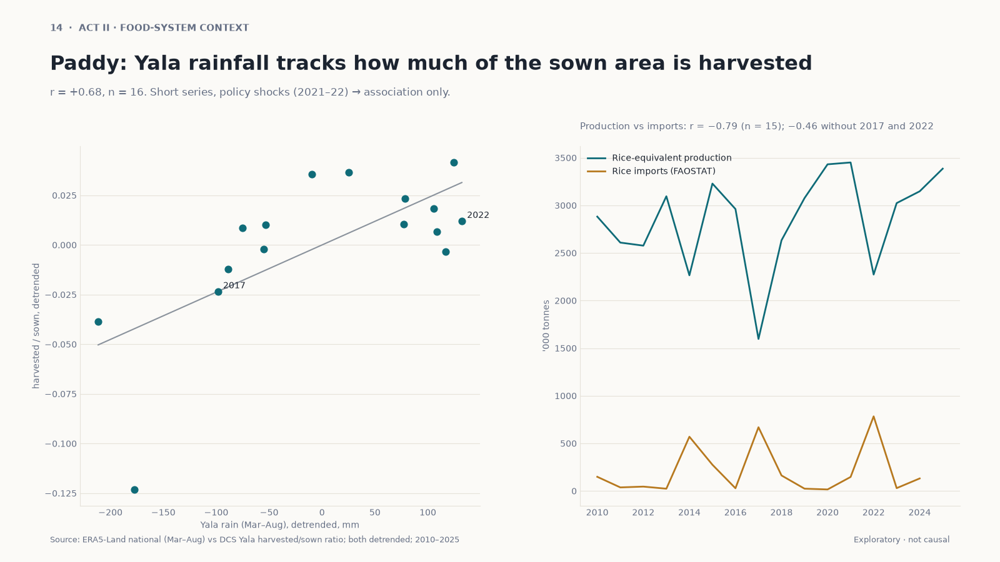

# 14 - Paddy: Yala rainfall and the harvested/sown ratio

**Story stage:** Wider implication

## What this page communicates
Seasonal rain relates to paddy outcomes in the national data, but production and imports move with crisis years.

## Why this page exists
Shows another weather route into the food system; separate from the forecasting model.

## What I explain
Left: detrended Yala (Mar-Aug) rain against detrended harvested/sown ratio, r about +0.68, n = 16. Right: rice-equivalent production against imports, r = -0.79 (n = 15), -0.46 without 2017 and 2022.

## Evidence
ERA5 monthly; `derived/dcs_national_yala.csv`; `derived/rice_annual_balance.csv`.

## Important qualification
n is small; policy and fertiliser shocks. Association only.

## Chart specification
Scatter with fitted line and two labelled years; line chart of production vs imports.

## Connection to the next page
Page 15 looks at the import side.
