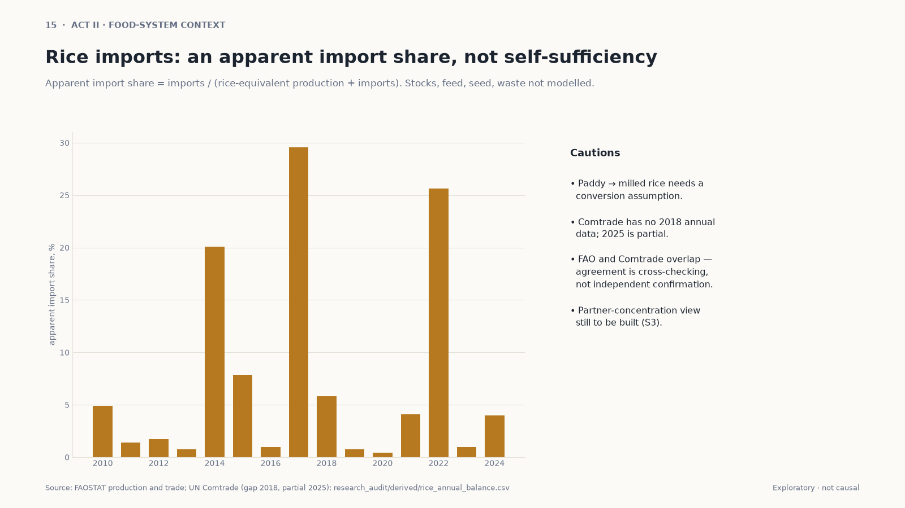

# 15 - Rice imports: apparent import share, not self-sufficiency

**Story stage:** Wider implication

## What this page communicates
Imports can be described as an apparent share of supply, with clear limits on interpretation.

## Why this page exists
Names the import-dependency leg of the original motivation.

## What I explain
Bars show imports/(production+imports) per year (FAOSTAT). Partner concentration (Comtrade) is the next piece to build.

## Evidence
`derived/rice_annual_balance.csv`; Comtrade summaries.

## Important qualification
Conversion paddy to rice is assumed; Comtrade lacks 2018 and partial 2025; FAO/Comtrade overlap is not independent confirmation.

## Chart specification
Bar chart of apparent share by year; caution list.

## Connection to the next page
Page 16 turns to the exchange rate.
