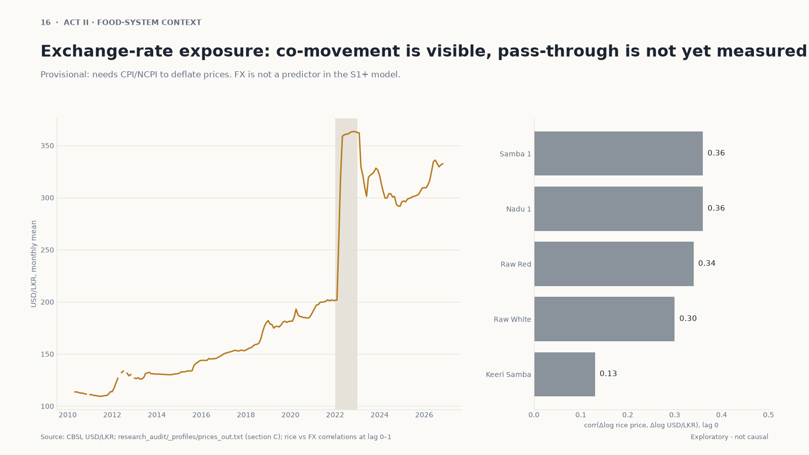

# 16 - Exchange rates: co-movement, not yet pass-through

**Story stage:** Wider implication

## What this page communicates
Rice prices move with USD/LKR at short lags, but without a deflator this is only co-movement.

## Why this page exists
Completes the three vulnerability dimensions honestly, flagged provisional.

## What I explain
Left: USD/LKR monthly mean, 2022 shaded. Right: lag-0 correlations of rice price changes with FX, 0.13-0.36.

## Evidence
CBSL exchange rates; `prices_out.txt` section C (small n).

## Important qualification
Needs CPI/NCPI to deflate. FX is not a predictor in the S1+ model.

## Chart specification
Line chart plus horizontal bars of correlations.

## Connection to the next page
Page 17 sets the three dimensions side by side.
