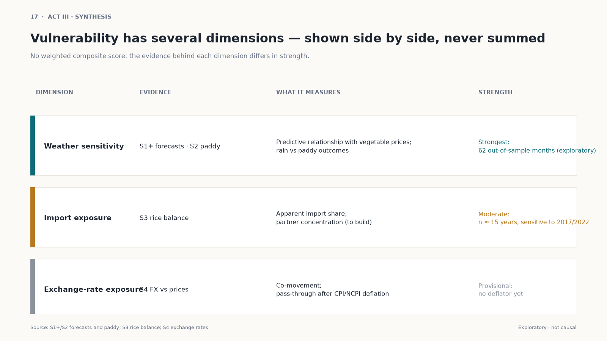

# 17 - Vulnerability has several dimensions, shown side by side

**Story stage:** Wider implication

## What this page communicates
Weather, import and exchange-rate exposure are different dimensions with different evidence strength.

## Why this page exists
Prevents a false single-chain story.

## What I explain
Three rows: what each measures and how strong the evidence is. No composite score.

## Evidence
Pages 9-16.

## Important qualification
Strength differs: forecasts strongest, imports moderate, FX provisional.

## Chart specification
Table-style matrix with strength labels.

## Connection to the next page
Page 18 closes.
