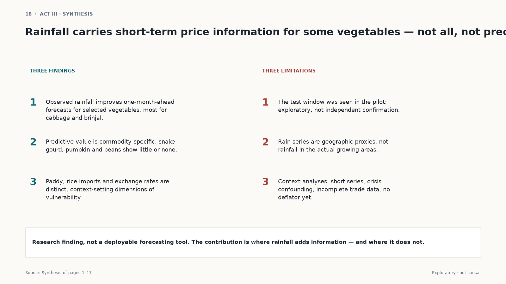

# 18 - Rainfall carries short-term price information for some vegetables

**Story stage:** Resolution

## What this page communicates
Rainfall helps selected vegetables, not all, and not precisely; the broader system has distinct vulnerabilities.

## Why this page exists
The empirical answer and its bounds, not a product pitch.

## What I explain
Three findings, three limitations, one boundary statement.

## Evidence
Whole story.

## Important qualification
Not a deployable forecasting tool.

## Chart specification
Two columns of numbered statements plus a footer box.

## Connection to the next page
End of story; next work: CPI/NCPI for the FX chapter and partner-concentration for rice.
