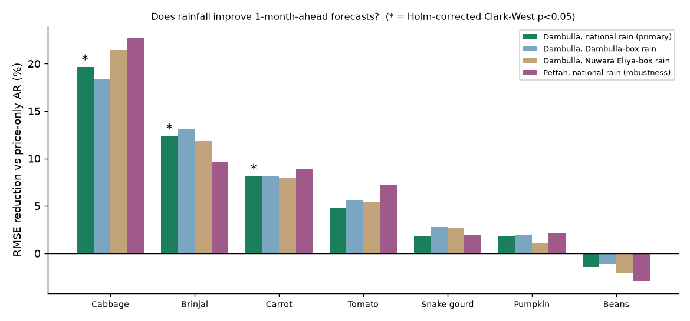

# Forecast Backtest v2 - Weather-informed vegetable price forecasting (S1+)

*Generated by `research_audit/forecast_backtest_v2.py`. Pilot (`forecast_pilot.py`) is unchanged. Raw and existing derived files untouched; one new cache file `derived/era5_regional_monthly.csv`.*

**Status: refined EXPLORATORY backtest.** The pilot had already shown us these test months, and the commodity list and rain idea came from it, so nothing below is an independent confirmation.

## 1. Question and design (frozen before the run)
Does adding past rainfall to a price-only autoregression reduce one-month-ahead forecast error for seven Dambulla wholesale vegetables? Rain is the only extra information; FX is excluded.

| Item | Decision |
|---|---|
| Target | ln(monthly mean wholesale price, LKR/kg) of month t+1 |
| Information at origin t | monthly prices through t; ERA5 rain through the end of t. Rain of t+1 is never used |
| Price aggregation | mean of valid daily prices; a month needs >= 10 daily prices else it is missing (no filling). Monthly median is a sensitivity check |
| Baselines | naive (y_t); seasonal naive (y_t-11, the same calendar month as the target one year earlier); price-only AR |
| AR | lag set chosen by AIC on the training window from {y_t}, {y_t,y_t-1}, {y_t,y_t-11}, {y_t,y_t-1,y_t-11}; OLS, refit each origin |
| AR+rain | the same lag set + A0 (anomaly of month t) + A3 (mean anomaly of months t-2, t-1, t). Lag set is chosen on the price-only model so both have identical price terms |
| Anomaly (primary) | (rain_t - mean of the same calendar month over ERA5 years strictly before year(t)) / 100 mm; ERA5 starts 2010 so the first test year has 6+ reference years |
| Anomaly (sensitivity) | fixed 2010-2015 climatology (mm); expanding-climatology z-score |
| Rain geography | **primary: national** land mean (cos-lat weighted, 541 land cells). **Secondary:** Dambulla box (36 cells) and Nuwara Eliya box (36 cells), +-0.3 deg around 7.86N 80.65E and 6.97N 80.77E. Hand-drawn, no district polygons; they are proxies, not the growers' rain |
| Evaluation | expanding window; test origins 2021-08 onward (n = 62 per commodity); earlier origins with >= 24 training rows only build error history |
| Intervals | 80 % = forecast + 10th/90th percentile of the model's own past out-of-sample errors (>= 12 errors needed) |
| Tests | Clark-West (nested models, one-sided, Newey-West lag 3); DM (NW lag 3, two-sided, supplementary); moving-block bootstrap of the squared-error differential (blocks 3/6/12, 4000 draws); Holm (and BH, exploratory) across the 7 commodities, **primary specification only** |
| Evidence label | *supported (corrected)*: RMSE gain > 0, Holm CW p < 0.05 and all bootstrap p < 0.10. *suggestive*: uncorrected CW p < 0.05 or all-block bootstrap p < 0.05 but not the above. Otherwise *no reliable evidence* / *worse or no gain* |

Forecast prices in LKR are exp(forecast of log price) (median-type forecast, no retransformation bias correction). Log RMSE is **not** a percentage error; MAE/RMSE in LKR/kg and MAPE are given beside it.

## 2. Out-of-sample forecast performance (Dambulla wholesale, primary)
| commodity | model | rmse_log | mae_log | mae_lkr | rmse_lkr | mape_pct |
|---|---|---|---|---|---|---|
| Beans | AR | 0.324 | 0.256 | 79.1 | 104 | 22.8 |
| Beans | AR+rain (nat) | 0.329 | 0.26 | 79.3 | 103 | 23.1 |
| Beans | naive | 0.336 | 0.254 | 81.9 | 112 | 26 |
| Beans | snaive | 0.417 | 0.336 | 101 | 124 | 29.6 |
| Brinjal | AR | 0.336 | 0.266 | 61.9 | 80.2 | 28.2 |
| Brinjal | AR+rain (nat) | 0.294 | 0.232 | 52.5 | 67.8 | 24.7 |
| Brinjal | naive | 0.376 | 0.295 | 69.2 | 92.8 | 30.8 |
| Brinjal | snaive | 0.499 | 0.394 | 81.2 | 105 | 36.4 |
| Cabbage | AR | 0.406 | 0.337 | 51.5 | 67.6 | 30.7 |
| Cabbage | AR+rain (nat) | 0.326 | 0.263 | 42 | 58.8 | 24 |
| Cabbage | naive | 0.429 | 0.355 | 53.7 | 67.4 | 35.9 |
| Cabbage | snaive | 0.926 | 0.752 | 113 | 142 | 77.5 |
| Carrot | AR | 0.397 | 0.308 | 85.3 | 143 | 28.7 |
| Carrot | AR+rain (nat) | 0.364 | 0.282 | 80.7 | 140 | 26.9 |
| Carrot | naive | 0.427 | 0.35 | 98 | 152 | 35.8 |
| Carrot | snaive | 0.738 | 0.602 | 157 | 228 | 62.9 |
| Pumpkin | AR | 0.403 | 0.312 | 28.3 | 39.9 | 26.4 |
| Pumpkin | AR+rain (nat) | 0.396 | 0.301 | 27.3 | 38.8 | 25.5 |
| Pumpkin | naive | 0.404 | 0.334 | 30.8 | 38.4 | 34.9 |
| Pumpkin | snaive | 0.711 | 0.575 | 52.7 | 66.7 | 58.5 |
| Snake gourd | AR | 0.33 | 0.264 | 42.4 | 54.1 | 25.4 |
| Snake gourd | AR+rain (nat) | 0.324 | 0.257 | 40.6 | 52.5 | 24.8 |
| Snake gourd | naive | 0.378 | 0.306 | 49.9 | 62.5 | 30.8 |
| Snake gourd | snaive | 0.456 | 0.372 | 56.6 | 68.8 | 34.8 |
| Tomato | AR | 0.61 | 0.476 | 95.5 | 132 | 39.9 |
| Tomato | AR+rain (nat) | 0.581 | 0.457 | 90.1 | 124 | 39.7 |
| Tomato | naive | 0.63 | 0.478 | 101 | 140 | 53 |
| Tomato | snaive | 0.883 | 0.725 | 143 | 186 | 72.2 |

*Per-commodity forecast charts: `forecast_charts_v2/<commodity>.png`.*

## 3. Does rain help? (Dambulla, national rain = PRIMARY)
RMSE gain = reduction in log RMSE relative to the price-only AR on the same forecast dates.

| commodity | n | rmse_gain_vs_AR_pct | cw_t | cw_p_one | cw_p_holm | cw_p_bh | boot_p_b3 | boot_p_b6 | boot_p_b12 | dm_p_two | evidence |
|---|---|---|---|---|---|---|---|---|---|---|---|
| Cabbage | 62 | 19.7 | 3.44 | 0.000292 | 0.00175 | 0.00102 | 0.00625 | 0.00525 | 0.002 | 0.00747 | supported (corrected) |
| Brinjal | 62 | 12.4 | 3.65 | 0.000132 | 0.000923 | 0.000923 | 0.003 | 0.0035 | 0.00225 | 0.0029 | supported (corrected) |
| Carrot | 62 | 8.16 | 2.53 | 0.0057 | 0.0285 | 0.0133 | 0.033 | 0.025 | 0.0205 | 0.0331 | supported (corrected) |
| Tomato | 62 | 4.75 | 1.92 | 0.0273 | 0.109 | 0.0478 | 0.144 | 0.16 | 0.15 | 0.295 | suggestive (uncorrected only) |
| Snake gourd | 62 | 1.83 | 1.53 | 0.0631 | 0.189 | 0.0884 | 0.253 | 0.262 | 0.28 | 0.512 | no reliable evidence |
| Pumpkin | 62 | 1.77 | 1.19 | 0.117 | 0.235 | 0.137 | 0.195 | 0.196 | 0.191 | 0.4 | no reliable evidence |
| Beans | 62 | -1.5 | -0.144 | 0.557 | 0.557 | 0.557 | 0.793 | 0.792 | 0.805 | 0.441 | worse or no gain |

## 4. Secondary and sensitivity specifications (exploratory; no family-wise claim)
RMSE gain (%) vs price-only AR, Dambulla wholesale:

| commodity | AR+rain:dam | AR+rain:nat | AR+rain:nat_fixedclim | AR+rain:nat_z | AR+rain:nuw |
|---|---|---|---|---|---|
| Cabbage | 18.3 | 19.7 | 16.8 | 15.9 | 21.5 |
| Brinjal | 13.1 | 12.4 | 10.6 | 13 | 11.8 |
| Carrot | 8.19 | 8.16 | 4.91 | 5.88 | 7.98 |
| Tomato | 5.55 | 4.75 | 3.19 | 1.72 | 5.39 |
| Snake gourd | 2.79 | 1.83 | 0.922 | 2.17 | 2.68 |
| Pumpkin | 1.99 | 1.77 | 1.13 | -0.0704 | 1.07 |
| Beans | -1.15 | -1.5 | -3.01 | -1.43 | -2.07 |

Monthly **median** instead of mean (national rain):

| commodity | rmse_gain_vs_AR_pct | cw_p_one | cw_p_holm |
|---|---|---|---|
| Cabbage | 21.8 | 0.000155 | 0.00108 |
| Brinjal | 10.9 | 0.00103 | 0.0062 |
| Carrot | 8.68 | 0.00508 | 0.0254 |
| Tomato | 4.27 | 0.0375 | 0.15 |
| Snake gourd | 2.85 | 0.0455 | 0.15 |
| Pumpkin | 2.52 | 0.0766 | 0.153 |
| Beans | -1.19 | 0.413 | 0.413 |

Corrected p-values for each secondary specification are in `forecast_model_comparison_v2.csv` (Holm within spec). Choosing the best of these specs per commodity would be a forking-paths search; the primary specification was fixed in advance.

## 4b. Is the gain driven by the 2022 crisis or one half of the sample?
RMSE gain (%) of AR+rain (national) over AR, Dambulla, on sub-samples of the same forecasts (not re-fitted):

| commodity | all | excl_2022_targets | first_half | second_half |
|---|---|---|---|---|
| Cabbage | 19.7 | 20.4 | 17.7 | 22.5 |
| Brinjal | 12.4 | 12.3 | 6.26 | 16.7 |
| Carrot | 8.16 | 8.53 | 7.71 | 8.63 |
| Tomato | 4.75 | 4.15 | 8.33 | -0.0124 |
| Snake gourd | 1.83 | 1.2 | 0.931 | 3.23 |
| Pumpkin | 1.77 | 2.67 | 3.25 | -0.199 |
| Beans | -1.5 | -0.851 | -1.25 | -1.83 |

## 5. Pettah robustness (same frozen model; NOT independent validation)
Pettah and Dambulla prices are strongly related and share the same weather, so agreement is consistency, not replication. Nothing was tuned on Pettah.

| commodity | n | rmse_gain_vs_AR_pct | cw_t | cw_p_one | cw_p_holm | cw_p_bh | boot_p_b3 | boot_p_b6 | boot_p_b12 | dm_p_two | evidence |
|---|---|---|---|---|---|---|---|---|---|---|---|
| Cabbage | 61 | 22.7 | 3.99 | 3.27e-05 | 0.000229 | 0.000201 | 0.00075 | 0.002 | 0.001 | 0.00128 | supported (corrected) |
| Brinjal | 61 | 9.67 | 3.86 | 5.74e-05 | 0.000344 | 0.000201 | 0.0152 | 0.0118 | 0.0095 | 0.0281 | supported (corrected) |
| Carrot | 61 | 8.85 | 2.97 | 0.00151 | 0.00755 | 0.00352 | 0.0302 | 0.0243 | 0.0127 | 0.0283 | supported (corrected) |
| Tomato | 61 | 7.16 | 2.34 | 0.0097 | 0.0388 | 0.017 | 0.102 | 0.113 | 0.0945 | 0.201 | suggestive (uncorrected only) |
| Snake gourd | 61 | 1.98 | 1.41 | 0.0789 | 0.237 | 0.11 | 0.292 | 0.277 | 0.292 | 0.584 | no reliable evidence |
| Pumpkin | 61 | 2.15 | 1.27 | 0.101 | 0.237 | 0.118 | 0.182 | 0.196 | 0.207 | 0.396 | no reliable evidence |
| Beans | 61 | -2.92 | -0.577 | 0.718 | 0.718 | 0.718 | 0.877 | 0.862 | 0.886 | 0.282 | worse or no gain |

## 6. Predictive uncertainty (Dambulla, 80 % intervals)
Nominal coverage 0.80. With ~62-62 test points the coverage estimate itself has a standard error of about 0.05.

| commodity | coverage_AR | coverage_AR+rain:nat | mean_width_lkr_AR | mean_width_lkr_AR+rain:nat |
|---|---|---|---|---|
| Cabbage | 0.694 | 0.774 | 140 | 125 |
| Brinjal | 0.71 | 0.839 | 187 | 179 |
| Carrot | 0.726 | 0.742 | 206 | 207 |
| Tomato | 0.694 | 0.742 | 256 | 262 |
| Snake gourd | 0.774 | 0.726 | 156 | 146 |
| Pumpkin | 0.839 | 0.839 | 107 | 106 |
| Beans | 0.694 | 0.774 | 232 | 253 |

## 7. Limitations
* ~62 forecast months, serially dependent; Clark-West/bootstrap have limited power and the normal approximation is rough.
* Pilot leakage of *selection*: commodities and the rain idea came after seeing the pilot test window. Holm covers only the 7-test family, not the earlier search.
* National and box rainfall are proxies for growing-area weather. Dambulla supplies come from several regions; boxes are hand-drawn; ERA5-Land at 0.1 deg smooths hill rain.
* Weather enters only as past rainfall; transport, policy, import controls, the 2022 crisis and inflation are not modelled. Prices are nominal, so inflation trends sit inside the AR terms.
* Coefficients are associations, not causal effects. Rain may proxy for harvest timing or demand.
* Horizons beyond one month would need rainfall forecasts and are not tested.
* Monthly mean of daily prices with a 10-day minimum; prices as published, units not independently verified.
* Interval coverage is estimated with few points and uses error history that is itself short.

## 8. Interpretation (written after inspecting the results)
**Descriptive history (separate from forecasting).** Earlier lagged correlations (03 audit) already pointed to cabbage, carrot and brinjal. They are associations with national rain and say nothing about forecast skill.

**Out-of-sample forecast performance.** Over 62 one-month-ahead forecasts per vegetable, adding past rain to the price-only AR lowered log RMSE by about 20 % (cabbage), 12 % (brinjal), 8 % (carrot), 5 % (tomato) and 2 % (snake gourd, pumpkin); beans were 1.5 % worse. In LKR/kg the cabbage MAE fell from about 52 to 42 and brinjal from about 62 to 53. Naive was hard to beat for beans and pumpkin. Seasonal naive was the worst baseline everywhere because prices trended up strongly (2022).

**Statistical significance (primary spec only, Holm over 7).** Cabbage (Holm p = 0.002), brinjal (0.001) and carrot (0.029) pass the Clark-West test after correction, and their block-bootstrap p-values are below 0.05 at blocks 3/6/12. Tomato is uncorrected-only (CW p = 0.027, Holm 0.11, bootstrap about 0.15). Snake gourd, pumpkin and beans show no reliable evidence. Treat the corrected result as **supported for cabbage and brinjal, weaker for carrot** (Holm 0.029 sits close to the line and its DM p is 0.033), **exploratory for tomato**, and as a clear negative for the other three.

**Robustness.** The conclusion survives Dambulla-box and Nuwara Eliya-box rain (similar or larger gains, Nuwara Eliya best for cabbage), the monthly median, and the Pettah market (agreement, not independence). Gains for cabbage and carrot are essentially unchanged when 2022 targets are removed and positive in both halves of the test window. Brinjal's gain is concentrated in the second half (6 % vs 17 %); tomato's gain disappears in the second half. The fixed 2010-2015 climatology and the z-score version give smaller gains (cabbage 17 % and 16 %, carrot 5 % and 6 %), so the anomaly definition matters; the sign pattern across vegetables does not change.

**Predictive uncertainty.** The 80 % intervals under-cover for most series (empirical coverage 0.69-0.84, mostly 0.70-0.78), so they are too narrow, mainly because early error history is short and 2022 errors are large. Do not present them as calibrated; they are a first, honest approximation. Interval width in LKR/kg is large (cabbage about 125-140, carrot about 206), which matches the large point errors: even the best model misses by roughly 24-40 % (MAPE; about 24-27 % for cabbage, brinjal and carrot).

**What is sufficiently supported for the chapter.**
* Cabbage and brinjal: rain adds out-of-sample information at a 1-month horizon beyond past prices (supported after multiple-testing correction, robust to geography, aggregation and the 2022 episode for cabbage).
* Carrot: modest and borderline; report as supported with a caution.
* Tomato: exploratory. Snake gourd, pumpkin, beans: no evidence; report as negative results.
* Not supported: any causal claim, any claim for markets beyond Dambulla/Pettah, any claim at 2-3 month horizons, calibrated intervals.

**Caveats that remain.** These test months were seen in the pilot, so even the corrected p-values do not account for that earlier look; ~62 dependent forecasts limit power; boxes are proxies; the fitted AR+rain price lag set (AIC-chosen) differs from the pilot's fixed lags, which is why the gains are not identical to the pilot.
